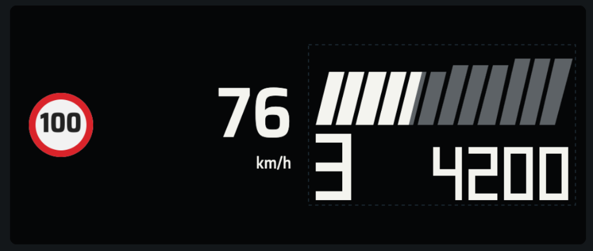

# ID6-Extended-HUD

Standalone BMW NBT Evo (iDrive 6) plugin and native QNX HUD worker that renders an M-style sequential rev bar (**Sport Bar**) and turn-by-turn navigation scene on the factory windscreen HUD of 6WB cars.

Tested on an F34 340i (B58), NBT Evo firmware `NBTevo_X20511I`, split-node unit (`hu-jacinto` SSH / `hu-omap` HMI).

Highlights:
- About **6 frames a second** on the factory HUD (pipelined MOST calls, ~160 ms a frame).
- Car data from the HMI's car data service (CDS): revs every ~100 ms, the real gear (shown in D/S/M, hidden in P/N/R) and the driving
  mode (Sport/Sport+ only unless "Always" is ticked). Never estimated.
- Gear blinks past a configurable Shift point (6,200–6,600 rpm).

## Special thanks

Special thanks to [inotbarnacle](https://github.com/inotbarnacle), the author of [ID6_apps_prerelease](https://github.com/inotbarnacle/ID6_apps_prerelease/tree/main). His findings and documentation were used to build and provide this plugin.

## Photos



## What is included

```text
ID6-Extended-HUD/
├── README.md
├── LICENSE                          # MIT (+ third-party/idrive7-apps-LICENSE)
├── docs/
│   ├── EXTENDEDHUD.md               # Architecture, HUDTerminal 82/02 map, install, troubleshooting
│   ├── HUD-DESIGN.md                # Factory HUD canvas, palette, latency, and Sport Bar design rules
│   ├── BUILD.md                     # QNX SDP 6.5 Docker build, ABI verification, packaging
│   └── MOST.md                      # HSFZ-to-MOST UDS tunnel fallback details
├── native/
│   ├── Makefile                     # Host tests (C99 + Python)
│   ├── build.sh                     # Full QNX build (libExtendedHUD.so + workers + librghook.so)
│   ├── build_hud.sh                 # Framework-free QNX build (workers + librghook.so)
│   ├── package.sh                   # Assembles standalone out/ExtendedHUD/ + SHA256SUMS + out/extended-hud.zip
│   ├── docker/                      # QNX SDP 6.5 x86 Docker toolchain wrapper
│   ├── plugin/                      # ExtendedHUD.manifest (connector 121), ExtendedHUD.xml, gateway-ip.txt
│   ├── sdk/                         # Minimal BMW RHMI SDK list header
│   ├── src/                         # extended_hud.cpp, hud/*, rghook/*, most/*, read-only OBD collector
│   ├── tests/                       # Host unit tests + fake DSI/DME harness
│   └── tools/                       # Mapbox glyph generator, desk HTML previewer, ABI auditor
├── tools/                           # hud_car_run.py (parked car-run gate), capture_headunit.py, unit tests
└── .claude/skills/                  # Agent workflow skills for HUD, car runs, DME reads, and deployment
```

## Architecture

```text
HmiMain3D ── libExtendedHUD.so        My Vehicle → ExtendedHUD menu, settings.txt, worker lifecycle
               │ spawn + SIGTERM
               ▼
             hud-sportbar-qnx         Draws to factory HUD over MOST FBlock 0x82 (HUDTerminal) inst 2
               │ posix_spawn                    ▲ UDP 127.0.0.1:42873, {sampled_ms, rpm, kph}
               ▼
             shift-deck-qnx           Read-only OBD 01 0C (RPM) & 01 0D (speed) → DME 0x12 (HSFZ or MOST)
```

- **Read-only diagnostics:** `shift-deck-qnx` sends only OBD service `01` (`01 0C` RPM, `01 0D` speed) and never writes to any ECU.
- **No HMI-thread blocking:** All drawing and diagnostics run in dedicated child processes outside `HmiMain3D`.
- **Single-sender safety:** Do not install or run alongside another HUD sender (`HudTest` / HUD Gauges, Wayglass); two HUDTerminal senders freeze the HUD. ExtendedHUD refuses to start when `HudTest` is present.

## Host tests and desk preview (no car or QNX SDK needed)

```sh
make -C native test
python3 -B -m unittest discover -s tools -p 'test_*.py'
python3 .claude/skills/extendedhud/check_app.py
python3 native/tools/hud_preview.py -o /tmp/hud-preview.html
```

## Build and package for QNX (NBT Evo)

Building `libExtendedHUD.so` requires QNX SDP 6.5 (ARM GCC 4.4.2) and your head unit's own `libAppFramework.A.so` and `libCoreFramework.A.so` placed in `native/frameworks/` (git-ignored; never commit BMW binaries). See [docs/BUILD.md](docs/BUILD.md) for Docker toolchain setup.

```sh
# Framework-free QNX workers only (hud-sportbar-qnx, shift-deck-qnx, librghook.so):
sh native/docker/qnx.sh build

# Full QNX build + self-contained ExtendedHUD/ bundle & zip with SHA256SUMS:
sh native/docker/qnx.sh package

# Verify every bmw:: symbol resolves against your car's frameworks before installing:
sh .claude/skills/deploy-plugins/abi_check.sh out/libExtendedHUD.so
```

`native/package.sh` validates that every QNX binary is an ARM ELF32 binary, stages `native/out/ExtendedHUD/`, and creates `native/out/extended-hud.zip` with verified `SHA256SUMS`.

## Install, update, and remove

See [docs/EXTENDEDHUD.md](docs/EXTENDEDHUD.md) for the full installation, hash-readback verification, atomic swap update, rollback, and troubleshooting procedures.

## Documentation

- [docs/EXTENDEDHUD.md](docs/EXTENDEDHUD.md) — runtime overview, HUDTerminal `82/02` handles, menu behavior, install & troubleshooting
- [docs/HUD-DESIGN.md](docs/HUD-DESIGN.md) — hardware constraints, palette indices, frame latency, and Sport Bar design rules
- [docs/BUILD.md](docs/BUILD.md) — QNX SDP 6.5 Docker build, framework ABI checks, and packaging
- [docs/MOST.md](docs/MOST.md) — HSFZ-to-MOST UDS tunnel fallback behavior and host test modes

## License and credits

This repository contains components under different licenses:

- **MIT License** ([LICENSE](LICENSE), plus [third-party/idrive7-apps-LICENSE](third-party/idrive7-apps-LICENSE)): ExtendedHUD plugin shell, HUD drawing/scenes, MOST/DSI transport, diagnostic link, read-only OBD collector, build/packaging scripts, car-run tools, and documentation. The shared MOST/DSI transport, diagnostic link, and RHMI plugin header foundation originated from the MIT-licensed `ID6_apps_prerelease` project.
- **PolyForm Noncommercial License 1.0.0** ([third-party/nbtevo-carplay-advanced-NOTICE](third-party/nbtevo-carplay-advanced-NOTICE)): CarPlay route-guidance components (`native/src/hud/hud_rg.h`, `native/src/hud/hud_rg.c`, and `native/src/rghook/rghook.c`), ported from `st1ng/nbtevo-carplay-advanced`. Because `hud_rg.c` is compiled into `hud-sportbar-qnx` (and `rghook.c` into `librghook.so`), those binaries are subject to PolyForm Noncommercial 1.0.0 terms (noncommercial use only).
- **ISC License**: Turn-by-turn navigation glyph geometry in `native/src/hud/hud_glyphs.h` is generated from `mapbox-navigation-ios` v0.40.0 (`ManeuversStyleKit.swift`, ISC notice preserved in header).
